# Launch design review screenshots

Captured from isolated local previews on 9 November 2026. Before = site PR commit `5427ece 8`; after = this change. No production settings, credentials or accounts were used. CSS viewports: phone 390×844, desktop 1280×900. Images are unaltered browser-recording frames; the recorder exports higher pixel dimensions than the CSS viewport. Reduced motion enabled. These are rendered UI checks, not successful OAuth, registration, payment or publishing tests.

The count is **19**, derived from the approved available-network list after adding LinkedIn personal profiles. The design note's 18 predates that addition. Company is required (3–128 characters), so its workspace purpose is explained. Password guidance reflects the existing 3–64-character validator, with no authentication policy change.

## Homepage desktop

Before: 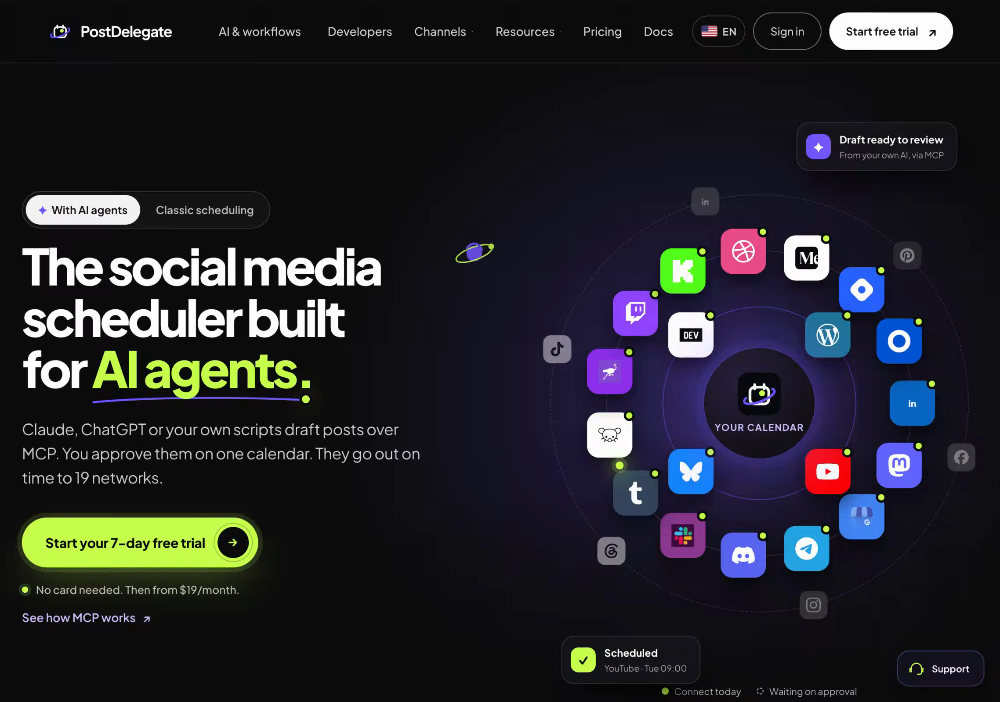

After: 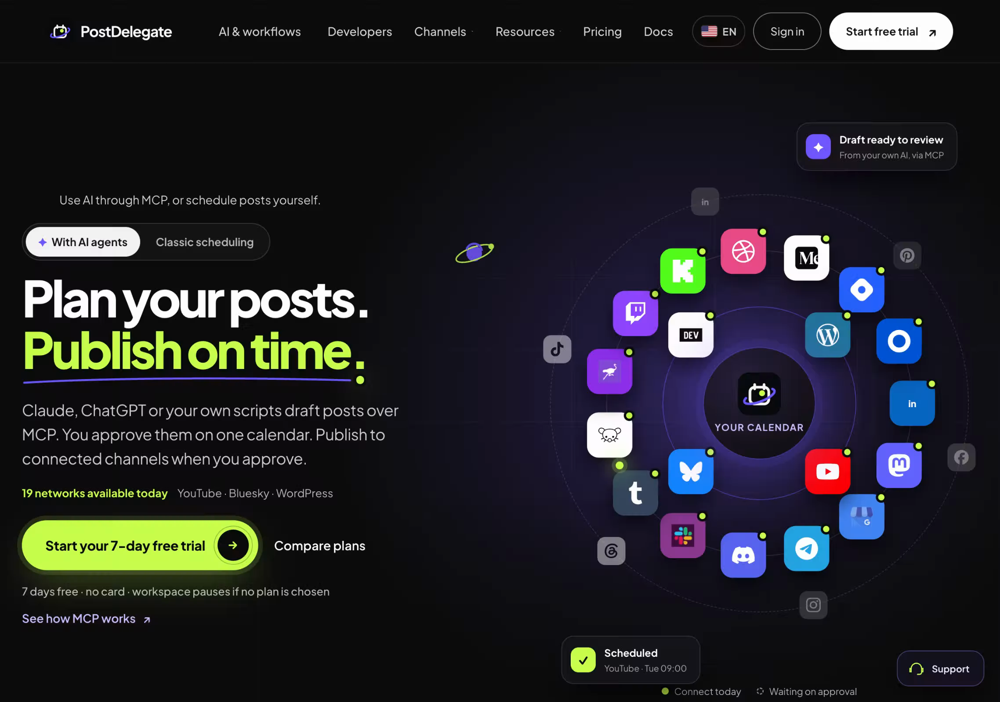

## Homepage phone

Before: 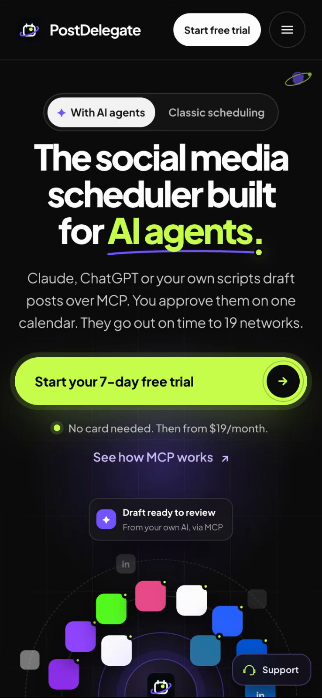

After: 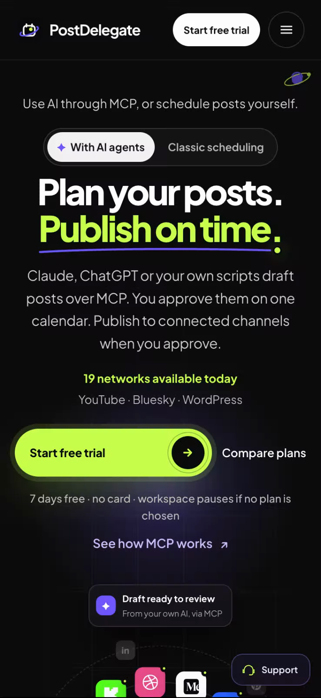

## Pricing desktop

Before: 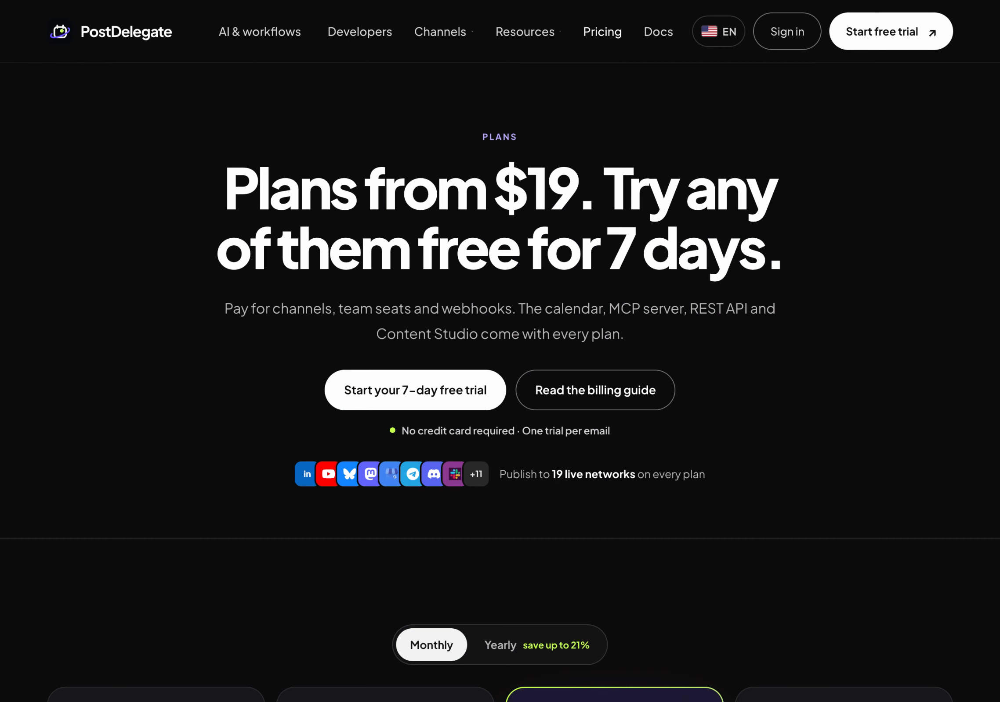

After: 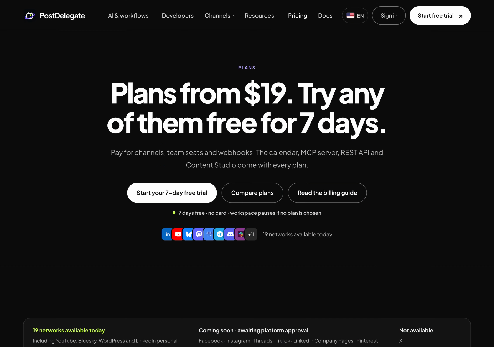

Coverage groups above the plan cards: 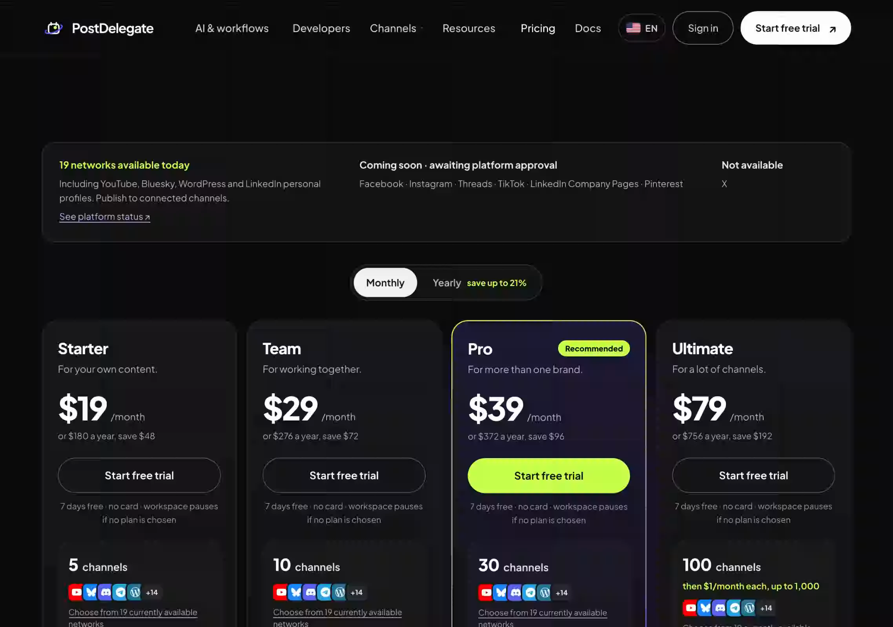

## Pricing phone

Before: 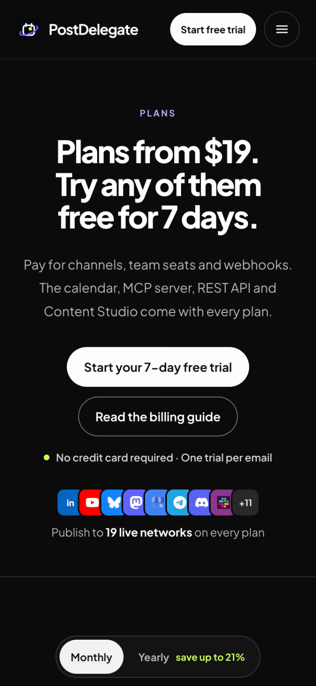

After: 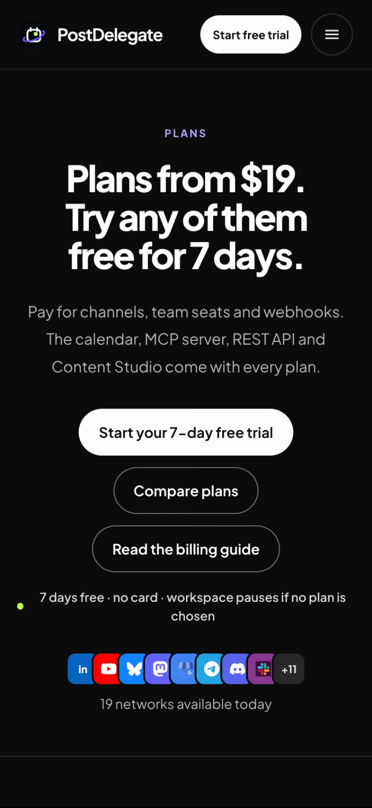

## Signup phone

Before: 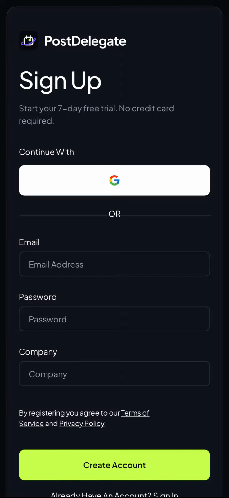

After: 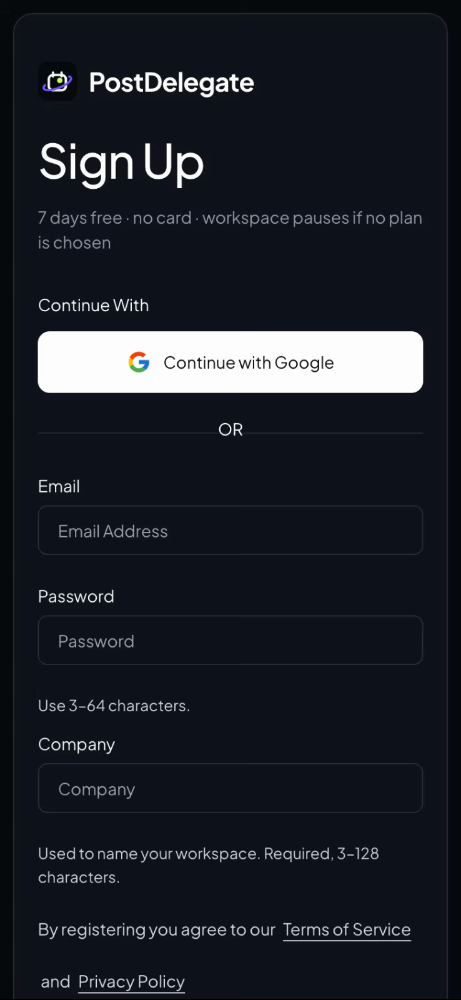

## Signup desktop

After: 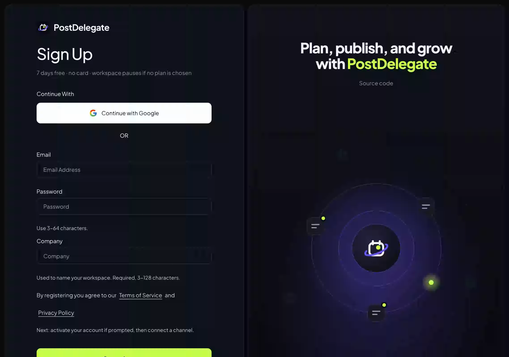

A desktop signup before capture was not retained. The phone comparison captures the reported Google-label defect; the desktop after image verifies the wider layout.

## Verification

- Site build: 485 pages, including OG cards and source packaging.
- Frontend TypeScript check passed. Independent source review performed; findings addressed.
- All seven homepage languages at 390px: no horizontal overflow; headline marks inside viewport; three coverage groups and closing trial terms present.
- Mode switch changes the visible workflow; Compare plans opens the pricing comparison anchor.
- Signup at 390/1280px: full Google label, correct helper descriptions and separate 44px-high legal links.
- Referral statement absent from all 485 HTML pages; valid-ref forwarding had already passed in this PR.
- Broad backend suite was stopped during heavy local resource pressure:72 suites had passed, no failures had been reported. The full suite is unverified for this update.
- Account creation, OAuth, billing and customer publishing are unverified. A blank local form validation attempt did not yield a usable result before the browser stalled under load; no successful registration is claimed.
- Next development HMR and a development font request were rejected by their origin check; signup screenshots may use a fallback font. No origin allowance or server configuration was changed; captures used page navigation. A Turbopack preview attempt also could not resolve the existing dependency symlink; the successful preview used Webpack.
